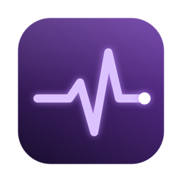
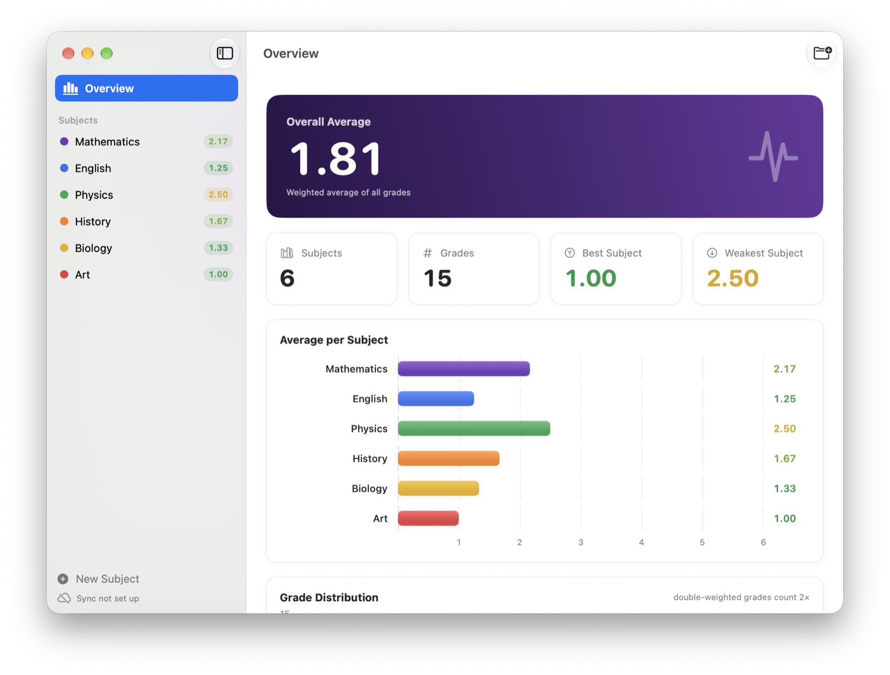

# NotePulse – Grade Tracker for macOS

A grade tracker for macOS: organize subjects, add weighted grades and see your averages and charts at a glance. Optional self-hosted sync with a web app (PHP + MySQL) for browser and phone.

**Download:** [latest release](../../releases/latest) → unzip, move NotePulse to Applications. On first launch right-click → Open (the app is not notarized).

**Build:** macOS 14+, Xcode Command Line Tools → `./build_app.sh`

**Web app:** upload `index + sql/html` to a PHP server, import `index + sql/sql/notepulse_schema.sql` into MySQL, copy `.env.example` to `.env` and fill it in.

Feedback and ideas are welcome – just open an [issue](../../issues).

MIT License © sami_i04

---
grade tracker, grade calculator, school grades app, student app, grade average calculator, self-hosted, pwa, php mysql, swift, macos
